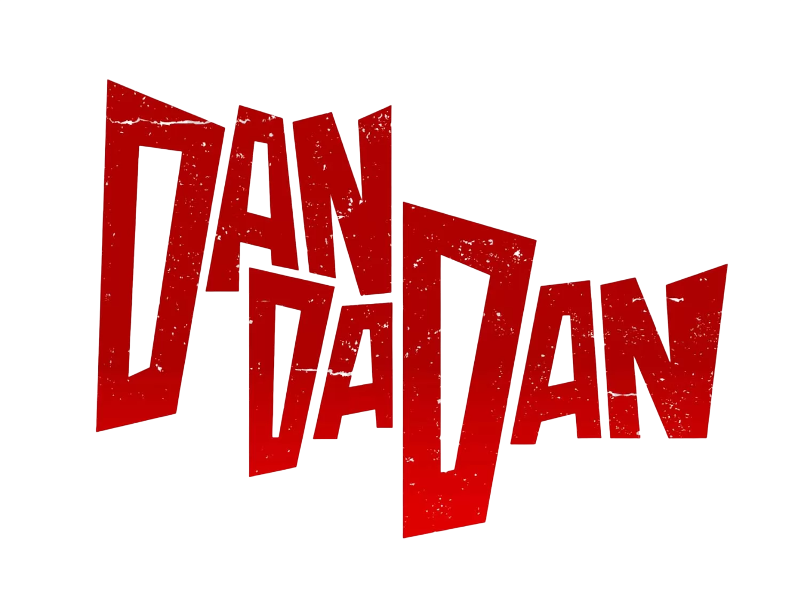
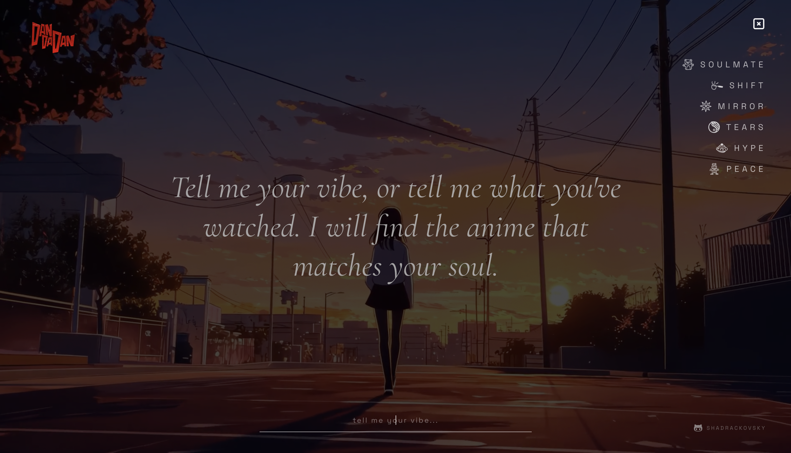

<p align="center">
    <a href="https://github.com/zuck30">
        
    </a>
</p>
this project is a cinematic, single-page anime recommendation engine. type your vibe, pick a mood, and the engine recommends an anime.

# features

- **backend:** supabase edge function (`supabase/functions/recommend/index.ts`) — a deno function that:
  - accepts `POST { vibe, mood }` with CORS.
  - calls deepseek (`deepseek-chat`) with a cinematic-oracle system prompt to get `anime_name`, `cinematic_text`, and `video_mood`.
  - looks up the poster via the jikan api (`api.jikan.moe/v4/anime`).
  - returns `{ cinematic_text, anime_name, poster_url, video_mood }`.
- **frontend:**
  - `VideoBackground` — `framer-motion` crossfade between the 6 videos based on `video_mood` (`calm→video-1`, `hype→video-2`, `action→video-3`, `mystery→video-4`, `sad→video-5`, default `video-6`), plus a heavily blurred poster color-bleed layer.
  - `HeroText` — fade/blur transitions for the cinematic line and loading state.
  - `Navbar` / `Menu` — minimal menu with mood items: `SOULMATE`, `SHIFT`, `MIRROR`, `TEARS`, `HYPE`, `PEACE`.
  - `page.tsx` — hidden vibe input opened with `/` or a click anywhere; triggers the supabase function and wires the response to the background, text, and poster.

# tech stack

- **next.js 16** (app router, turbopack, tailwind css v4)
- **react 19**, **framer-motion**
- **supabase** (client + edge functions)
- **deepseek** (chat completions) and **jikan** (for anime metadata)

# getting started

```bash
npm install
cp env.example .env.local
# edit .env.local with your supabase and deepseek keys
npm run dev
```

open [http://localhost:3000](http://localhost:3000).

# environment variables

| variable | required | where used |
| --- | --- | --- |
| `NEXT_PUBLIC_SUPABASE_URL` | yes | `src/lib/supabase.ts` |
| `NEXT_PUBLIC_SUPABASE_ANON_KEY` | yes | `src/lib/supabase.ts` |
| `DEEPSEEK_API_KEY` | yes | `supabase/functions/recommend/index.ts` (deno env) |

deploy the edge function to supabase:

```bash
supabase functions deploy recommend
supabase secrets set DEEPSEEK_API_KEY=your-key
```

# project structure

```
dandadan/
├── public/
│   ├── logo.png            # favicon + wordmark
│   └── videos/video-1..6.mp4
├── src/
│   ├── app/
│   │   ├── layout.tsx      # fonts, metadata, favicon
│   │   ├── page.tsx        # state, api wiring, hidden vibe input
│   │   └── globals.css     # dark base, grain overlay, overflow hidden
│   ├── components/
│   │   ├── Navbar.tsx
│   │   ├── Menu.tsx
│   │   ├── HeroText.tsx
│   │   └── VideoBackground.tsx
│   └── lib/supabase.ts
├── supabase/functions/recommend/index.ts
└── env.example
```

# build & lint

```bash
npm run build
npm run lint
```

<p align="center">
    <a href="https://github.com/zuck30">
        
    </a>
</p>

# credits

- creator: **shadrackovsky** :[github](https://zuck30.github.io/zuck30/)