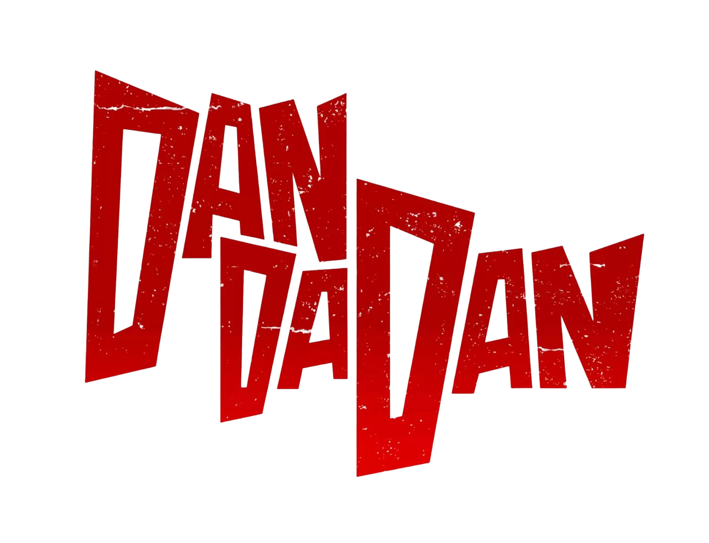

<p align="center">
    <a href="https://github.com/zuck30">
        
    </a>
</p>

<h3 align="center">type your vibe. pick a mood. the oracle picks the anime.</h3>

<p align="center">
    a cinematic, single-page anime recommendation engine powered by deepseek, supabase edge functions, and the jikan api.
</p>

<p align="center">
    <a href="https://nextjs.org"></a>
    <a href="https://react.dev"></a>
    <a href="https://www.typescriptlang.org"></a>
    <a href="https://tailwindcss.com"></a>
    <a href="https://supabase.com"></a>
    <a href="https://www.framer.com/motion"></a>
    <a href="/LICENSE"></a>
</p>

<p align="center">
    <a href="/public/shot.png"></a>
</p>

# features

- **cinematic background** — six looping videos crossfade with `framer-motion` based on the mood of the returned recommendation, layered with a heavily blurred color-bleed taken from the anime poster.
- **one-input interaction** — press `/` or click anywhere to open the hidden vibe prompt. hit `Escape` to dismiss.
- **mood menu** — pick a preset mood instead of typing: `SOULMATE`, `SHIFT`, `MIRROR`, `TEARS`, `HYPE`, `PEACE`.
- **deepseek oracle** — the edge function prompts `deepseek-chat` for a single anime plus a 2–3 sentence cinematic justification, returned as structured json.
- **poster lookup** — the returned title is resolved against the jikan api so the ui can display real cover art.
- **graceful degradation** — if supabase or the oracle is unavailable, the app still renders and shows a themed fallback message instead of crashing.

# how it works

1. you submit a vibe, a mood, or both.
2. the client calls the `recommend` supabase edge function.
3. the function asks deepseek for `anime_name`, `cinematic_text`, and `video_mood`.
4. the title is looked up on jikan for a poster url.
5. the response drives the hero text, the background video, and the poster layer.

# tech stack

| layer | choice |
| --- | --- |
| framework | next.js 16 (app router, turbopack) |
| language | typescript 5 |
| styling | tailwind css v4 |
| animation | framer-motion |
| backend | supabase edge functions (deno) |
| inference | deepseek chat completions |
| metadata | jikan api |

# quick start

### prerequisites

- node `>= 20.9.0` (the repo pins `22` via `.nvmrc`)
- a supabase project with the `recommend` function deployed
- a deepseek api key

### install and run

```bash
git clone https://github.com/zuck30/dandadan.git
cd dandadan
npm install
cp .env.example .env.local
# fill in .env.local with your supabase keys
npm run dev
```

open [http://localhost:3000](http://localhost:3000).

# environment variables

| variable | required | used by |
| --- | --- | --- |
| `NEXT_PUBLIC_SUPABASE_URL` | yes | `src/lib/supabase.ts` |
| `NEXT_PUBLIC_SUPABASE_ANON_KEY` | yes | `src/lib/supabase.ts` |
| `DEEPSEEK_API_KEY` | yes | `supabase/functions/recommend/index.ts` |

`DEEPSEEK_API_KEY` is consumed by the edge function at runtime, not by the browser. keep it in supabase secrets for deployed environments.

# supabase edge function

the function lives at `supabase/functions/recommend/index.ts` and exposes a single `POST` endpoint with cors enabled.

**request**

```json
{ "vibe": "rainy tokyo rooftop", "mood": "MIRROR" }
```

**response**

```json
{
  "anime_name": "Serial Experiments Lain",
  "cinematic_text": "...",
  "poster_url": "https://cdn.myanimelist.net/images/anime/...",
  "video_mood": "mystery"
}
```

`video_mood` is constrained to `action`, `sad`, `calm`, `mystery`, or `hype`, which map to `video-3`, `video-5`, `video-1`, `video-4`, and `video-2` respectively, with `video-6` as the default.

deploy it with the supabase cli:

```bash
supabase login
supabase link --project-ref <your-project-ref>
supabase secrets set DEEPSEEK_API_KEY=your-key
supabase functions deploy recommend
```

# scripts

| command | description |
| --- | --- |
| `npm run dev` | start the dev server with turbopack |
| `npm run build` | create a production build |
| `npm run start` | serve the production build |
| `npm run lint` | run eslint |

# project structure

```
dandadan/
├── public/
│   ├── logo.png                # wordmark
│   ├── shot.png                # readme screenshot
│   ├── favicon-*.png
│   └── videos/video-1..6.mp4   # mood backgrounds
├── src/
│   ├── app/
│   │   ├── layout.tsx          # fonts, metadata, favicon
│   │   ├── page.tsx            # state, edge function wiring, hidden input
│   │   └── globals.css         # dark base, grain overlay
│   ├── components/
│   │   ├── Navbar.tsx
│   │   ├── Menu.tsx            # mood presets
│   │   ├── HeroText.tsx        # cinematic line + loading state
│   │   └── VideoBackground.tsx # crossfade + poster color bleed
│   └── lib/supabase.ts
├── supabase/functions/recommend/index.ts
├── .env.example
├── .nvmrc
└── vercel.json
```

# deploy to vercel

the repo ships deploy-ready: `vercel.json` pins the next.js preset and uses `npm ci`, `.nvmrc` pins node 22, and `.vercelignore` keeps local secrets and the supabase function out of the upload.

1. **set the environment variables** in vercel → project → settings → environment variables (production, preview and development):

   | name | value |
   | --- | --- |
   | `NEXT_PUBLIC_SUPABASE_URL` | `https://<project-ref>.supabase.co` |
   | `NEXT_PUBLIC_SUPABASE_ANON_KEY` | your supabase anon/publishable key |

   `DEEPSEEK_API_KEY` belongs to the supabase edge function, not vercel.

2. **deploy** one of these ways:

   ```bash
   # with the vercel cli
   npx vercel login
   npx vercel link          # link this folder to the project
   npx vercel --prod        # create a production deployment
   ```

   or push to `main` if the project is connected to github under settings → git.

3. **confirm the domain** under project → settings → domains. the production domain only serves traffic after a successful production deployment.

### troubleshooting

- **no production deployment / domain not serving traffic** — check the response headers on `https://<your-domain>`. an `x-vercel-error: DEPLOYMENT_DISABLED` header with http `402 Payment required` means vercel has disabled deployments for the account or project for billing reasons. fix the payment method, spend limit, or account status in the vercel dashboard; no code change can bypass this.
- **no deployment exists at all** — the repository is probably not connected under settings → git, or only preview/cli deploys have been made. run `npx vercel --prod`, or connect the repo and push to `main`.
- **verify the build locally** to rule out the code:

  ```bash
  npm ci && npm run build
  ```

# credits

built by **shadrackovsky** — [zuck30.github.io](https://zuck30.github.io/zuck30/)

criteria for a recommendation, poster data, and anime metadata are provided by the [jikan api](https://jikan.moe). reasoning is generated by [deepseek](https://deepseek.com).

# license

released under the [mit license](LICENSE) © 2026 timothy zucker.
