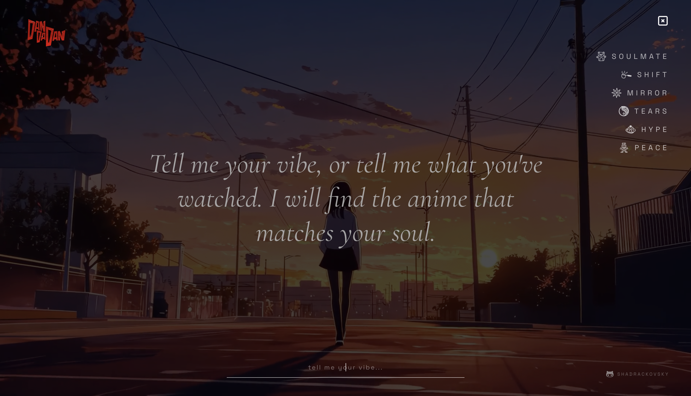

<p align="center">
    <a href="https://github.com/zuck30">
        
    </a>
</p>

<h3 align="center">Type Your Vibe. Pick a Mood. The Oracle Picks the Anime.</h3>

<p align="center">
    A cinematic, single-page anime recommendation engine powered by DeepSeek, Supabase Edge Functions, and the Jikan API.
</p>

<p align="center">
    <a href="https://nextjs.org"></a>
    <a href="https://react.dev"></a>
    <a href="https://www.typescriptlang.org"></a>
    <a href="https://tailwindcss.com"></a>
    <a href="https://supabase.com"></a>
    <a href="https://www.framer.com/motion"></a>
    <a href="/LICENSE"></a>
</p>

<p align="center">
    <a href="/public/shot.png"></a>
</p>

# Features

- **Cinematic Background:** Six looping videos crossfade with `framer-motion` based on the mood of the returned recommendation, layered with a heavily blurred color bleed taken from the anime poster.
- **One-Input Interaction:** Press `/` or click anywhere to open the hidden vibe prompt. Hit `Escape` to dismiss.
- **Mood Menu:** Pick a preset mood instead of typing: `SOULMATE`, `SHIFT`, `MIRROR`, `TEARS`, `HYPE`, `PEACE`.
- **DeepSeek Oracle:** The edge function prompts `deepseek-chat` for a single anime plus a 2 to 3 sentence cinematic justification, returned as structured JSON.
- **Poster Lookup:** The returned title is resolved against the Jikan API so the UI can display real cover art.
- **Graceful Degradation:** If Supabase or the oracle is unavailable, the app still renders and shows a themed fallback message instead of crashing.

# How It Works

1. You submit a vibe, a mood, or both.
2. The client calls the `recommend` Supabase Edge Function.
3. The function asks DeepSeek for `anime_name`, `cinematic_text`, and `video_mood`.
4. The title is looked up on Jikan for a poster URL.
5. The response drives the hero text, the background video, and the poster layer.

# Tech Stack

<div align="center">

| Layer | Choice |
| --- | --- |
| Framework | Next.js 16 (App Router, Turbopack) |
| Language | TypeScript 5 |
| Styling | Tailwind CSS v4 |
| Animation | Framer Motion |
| Backend | Supabase Edge Functions (Deno) |
| Inference | DeepSeek Chat Completions |
| Metadata | Jikan API |

</div>

# Quick Start

### Prerequisites

- Node `>= 20.9.0` (the repo pins `22` via `.nvmrc`)
- A Supabase project with the `recommend` function deployed
- A DeepSeek API key

### Install and Run

```bash
git clone https://github.com/zuck30/dandadan.git
cd dandadan
npm install
cp .env.example .env.local
# Fill in .env.local with your Supabase keys
npm run dev
```

Open [http://localhost:3000](http://localhost:3000).

# Environment Variables

<div align="center">

| Variable | Required | Used By |
| --- | --- | --- |
| `NEXT_PUBLIC_SUPABASE_URL` | Yes | `src/lib/supabase.ts` |
| `NEXT_PUBLIC_SUPABASE_ANON_KEY` | Yes | `src/lib/supabase.ts` |
| `DEEPSEEK_API_KEY` | Yes | `supabase/functions/recommend/index.ts` |

</div>

`DEEPSEEK_API_KEY` is consumed by the edge function at runtime, not by the browser. Keep it in Supabase secrets for deployed environments.

# Supabase Edge Function

The function lives at `supabase/functions/recommend/index.ts` and exposes a single `POST` endpoint with CORS enabled.

**Request**

```json
{ "vibe": "rainy tokyo rooftop", "mood": "MIRROR" }
```

**Response**

```json
{
  "anime_name": "Serial Experiments Lain",
  "cinematic_text": "...",
  "poster_url": "https://cdn.myanimelist.net/images/anime/...",
  "video_mood": "mystery"
}
```

`video_mood` is constrained to `action`, `sad`, `calm`, `mystery`, or `hype`, which map to `video-3`, `video-5`, `video-1`, `video-4`, and `video-2` respectively, with `video-6` as the default.

Deploy it with the Supabase CLI:

```bash
supabase login
supabase link --project-ref <your-project-ref>
supabase secrets set DEEPSEEK_API_KEY=your-key
supabase functions deploy recommend
```

# Scripts

<div align="center">

| Command | Description |
| --- | --- |
| `npm run dev` | Start the dev server with Turbopack |
| `npm run build` | Create a production build |
| `npm run start` | Serve the production build |
| `npm run lint` | Run ESLint |

</div>

# Project Structure

```
dandadan/
├── public/
│   ├── logo.png                # wordmark
│   ├── shot.png                # readme screenshot
│   ├── favicon-*.png
│   └── videos/video-1..6.mp4   # mood backgrounds
├── src/
│   ├── app/
│   │   ├── layout.tsx          # fonts, metadata, favicon
│   │   ├── page.tsx            # state, edge function wiring, hidden input
│   │   └── globals.css         # dark base, grain overlay
│   ├── components/
│   │   ├── Navbar.tsx
│   │   ├── Menu.tsx            # mood presets
│   │   ├── HeroText.tsx        # cinematic line + loading state
│   │   └── VideoBackground.tsx # crossfade + poster color bleed
│   └── lib/supabase.ts
├── supabase/functions/recommend/index.ts
├── .env.example
├── .nvmrc
└── vercel.json
```

# Deploy to Vercel

The repo ships deploy-ready: `vercel.json` pins the Next.js preset and uses `npm ci`, `.nvmrc` pins Node 22, and `.vercelignore` keeps local secrets and the Supabase function out of the upload.

1. **Set the environment variables** in Vercel → Project → Settings → Environment Variables (Production, Preview, and Development):

   <div align="center">

   | Name | Value |
   | --- | --- |
   | `NEXT_PUBLIC_SUPABASE_URL` | `https://<project-ref>.supabase.co` |
   | `NEXT_PUBLIC_SUPABASE_ANON_KEY` | Your Supabase anon/publishable key |

   </div>

   `DEEPSEEK_API_KEY` belongs to the Supabase Edge Function, not Vercel.

2. **Deploy** using one of these options:

   ```bash
   # With the Vercel CLI
   npx vercel login
   npx vercel link          # link this folder to the project
   npx vercel --prod        # create a production deployment
   ```

   Or push to `main` if the project is connected to GitHub under Settings → Git.

3. **Confirm the domain** under Project → Settings → Domains. The production domain only serves traffic after a successful production deployment.

### Troubleshooting

- **No production deployment / domain not serving traffic:** Check the response headers on `https://<your-domain>`. An `x-vercel-error: DEPLOYMENT_DISABLED` header with HTTP `402 Payment required` means Vercel has disabled deployments for the account or project for billing reasons. Fix the payment method, spend limit, or account status in the Vercel dashboard; no code change can bypass this.
- **No deployment exists at all:** The repository is probably not connected under Settings → Git, or only preview/CLI deploys have been made. Run `npx vercel --prod`, or connect the repo and push to `main`.
- **Verify the build locally** to rule out the code:

  ```bash
  npm ci && npm run build
  ```

# Credits

Built by **Shadrackovsky** ([zuck30.github.io](https://zuck30.github.io/zuck30/)).

Criteria for a recommendation, poster data, and anime metadata are provided by the [Jikan API](https://jikan.moe). Reasoning is generated by [DeepSeek](https://deepseek.com).

# License

Released under the [MIT License](LICENSE) © 2026 Timothy Zucker.
